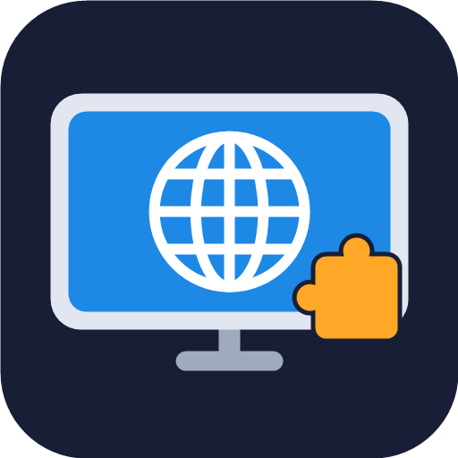

<p align="center"></p>

# TV Browser

A web browser for Amazon Fire TV (and other Android TV devices) that you drive with the remote and that supports **add-ons**, including uBlock Origin.

It is built on Mozilla's [GeckoView](https://geckoview.dev) (the Firefox engine), so it installs Firefox for Android add-ons from [addons.mozilla.org](https://addons.mozilla.org/android/).

> "TV Browser" is a placeholder name. This is an early prototype (v0.1.0).

## Which APK do I need?

Each release has two APKs:

| File | For |
|---|---|
| `TVBrowser-v0.1.0-armeabi-v7a.apk` | **Pick this one if unsure.** Works on every Fire TV Stick, including 64-bit ones running a 32-bit system. |
| `TVBrowser-v0.1.0-arm64-v8a.apk` | 64-bit devices with a 64-bit system (e.g. newer Fire TV Cube, Google TV, NVIDIA Shield). Slightly faster there. |

Stable links that always point to the newest release:

- 32-bit (safe choice): `https://github.com/Cyberhex1/tv-browser/releases/latest/download/TVBrowser-armeabi-v7a.apk`
- 64-bit: `https://github.com/Cyberhex1/tv-browser/releases/latest/download/TVBrowser-arm64-v8a.apk`

## Install on a Fire TV with the Downloader app

1. On the Fire TV, install **Downloader** (by AFTVnews) from the Amazon Appstore.
2. Go to **Settings → My Fire TV → Developer Options**.
   If you don't see Developer Options: open **Settings → My Fire TV → About** and press Select on your device name 7 times.
3. In Developer Options, open **Install unknown apps** and turn it **on** for **Downloader**.
4. Open Downloader, type the 32-bit link above into the URL box and press **Go**.
5. When the download finishes, choose **Install**. You can delete the APK file afterwards.
6. TV Browser now appears under **Your Apps & Channels**.

To update later, repeat steps 4–5. The new version installs over the old one and keeps your add-ons.

## Using it with the remote

| Button | Does |
|---|---|
| D-pad | Moves the on-screen cursor (hold to speed up). Push against an edge to scroll the page. |
| Select (centre) | Clicks where the cursor is. |
| Back | Goes back a page. On the first page it asks whether to exit. |
| Menu (☰) | Shows or hides the top bar: Back, Forward, Reload, Home, address bar and **Add-ons**. Extension buttons appear here too. |
| Rewind / Fast-forward | Scroll up / down a page. |

## Add-ons

Open the top bar (Menu) and choose **Add-ons**:

- **Installed:** turn add-ons on or off, open their settings, or remove them.
- **Popular add-ons:** the most-used Firefox for Android add-ons, installed with one press. uBlock Origin is listed first.

Extensions with a toolbar button (like uBlock Origin) show up in the top bar. Pressing one opens its panel, which you control with the cursor.

## Building

Requirements: JDK 17+, Android SDK with platform 37. The Gradle wrapper downloads everything else.

```powershell
cd app
.\gradlew.bat assembleDebug   # debug APKs in app\app\build\outputs\apk\debug
.\gradlew.bat dist            # signed release APKs copied to ..\dist (needs keystore.properties)
```

Release signing reads `keystore.properties` next to this README (not in git):

```
storeFile=keystore/release.jks
storePassword=...
keyAlias=tvbrowser
keyPassword=...
```

## License

App code: MPL-2.0. GeckoView is © Mozilla, MPL-2.0. This project is not affiliated with or endorsed by Mozilla or Amazon.
