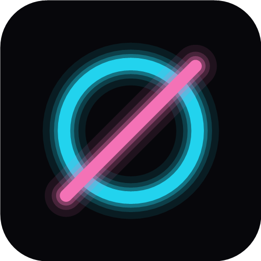

<p align="center"></p>

# Zero Browser

A web browser for Amazon Fire TV (and other Android TV devices) that you drive with the remote and that supports **add-ons**, including uBlock Origin.

It is built on Mozilla's [GeckoView](https://geckoview.dev) (the Firefox engine), so it installs Firefox for Android add-ons from [addons.mozilla.org](https://addons.mozilla.org/android/).

> Early prototype (v0.3.1). Formerly "TV Browser": if you installed v0.1.0, uninstall it first, since Zero Browser is a separate app.

## Which APK do I need?

First check your Fire OS version: **Settings → My Fire TV → About → Fire TV Stick** (look for "Fire OS").

| Your device | File | Downloader link (always the newest release) |
|---|---|---|
| **Fire OS 7 or 8** (Android 9/11), most sticks from 2019 on. **Pick this if unsure.** | `ZeroBrowser-armeabi-v7a.apk` | `https://github.com/Cyberhex1/zero-browser/releases/latest/download/ZeroBrowser-armeabi-v7a.apk` |
| **Fire OS 5 or 6** (Android 5–7), e.g. Fire TV Stick 4K 1st gen (2018), Fire TV Stick 2nd gen | `ZeroBrowser-legacy-armeabi-v7a.apk` | `https://github.com/Cyberhex1/zero-browser/releases/latest/download/ZeroBrowser-legacy-armeabi-v7a.apk` |
| 64-bit devices with a 64-bit system (e.g. NVIDIA Shield, Google TV) | `ZeroBrowser-arm64-v8a.apk` | `https://github.com/Cyberhex1/zero-browser/releases/latest/download/ZeroBrowser-arm64-v8a.apk` |

If the installer says **"There was a problem parsing the package"**, your Fire OS is too old for the normal APK: use the legacy one.

**About the legacy build:** Mozilla stopped supporting Android 5–7 after Firefox 144, so the legacy APK uses the GeckoView 144 engine (October 2025). It has all of Zero Browser's features, but **its engine gets no further security updates from Mozilla**. Use the normal APK whenever your device supports it. The files with a version number in the name on each release are the same APKs with the version added.

## Install on a Fire TV with the Downloader app

1. On the Fire TV, install **Downloader** (by AFTVnews) from the Amazon Appstore.
2. Go to **Settings → My Fire TV → Developer Options**.
   If you don't see Developer Options: open **Settings → My Fire TV → About** and press Select on your device name 7 times.
3. Allow app installs from Downloader:
   - Fire OS 7/8: open **Install unknown apps** and turn it **on** for **Downloader**.
   - Fire OS 5/6: turn **Apps from Unknown Sources** **on**.
4. Open Downloader, type the link for your device (from the table above) into the URL box and press **Go**.
5. When the download finishes, choose **Install**. You can delete the APK file afterwards.
6. Zero Browser now appears under **Your Apps & Channels**.

To update later, repeat steps 4–5. The new version installs over the old one and keeps your add-ons.

## Features

- **Zero Home**: a TV home screen with a big search/address box, a **Saved** row of page tiles and a **Recent** row of the last 10 pages. Hold Select (or press Menu) on a tile to open, rename, move or remove it; "+ Add a page" adds one by address.
- **Arcade look**: black screens, neon cyan and pink accents, square corners and glowing outlined tiles, set in Space Grotesk.
- **★ Save**: the ★ button in the top bar pins the current page to Zero Home, with a screenshot of the page as its tile.
- **Settings**: home page (Zero Home or any address), search engine (Google, DuckDuckGo, Bing), desktop or mobile sites, cursor speed and hide delay, clearing history / cookies / saved pages, and a built-in **Controls** guide.
- **Add-ons**: Firefox for Android add-ons such as uBlock Origin, installed with one press.
- A remote-driven cursor for any website. Web pages fill the whole screen; if your TV cuts off the edges, turn on **Settings → General → Screen border** (Small or Large).
- Built for low-memory TV sticks: on devices with under 3 GB of RAM it uses mobile sites by default (desktop is one setting away) and a single page process, and the first launch offers to install uBlock Origin.

## Using it with the remote

| Button | Does |
|---|---|
| D-pad | Moves the cursor. Tap for small steps; hold to move faster. Push against a screen edge to scroll the page. |
| Select (centre) | Clicks where the cursor is. Hold for a long-press. |
| Rewind / Fast-forward | Scroll up / down one screen. |
| Back | Goes back a page; from the first page it returns to Zero Home. Also closes the top bar, extension panels and fullscreen video. On Zero Home it asks whether to exit. |
| Menu (☰) | Shows or hides the top bar: address bar, Back, Forward, Reload, Home, ★ Save, Add-ons, Settings. On Zero Home it opens the options for the selected tile. |
| On Zero Home and in menus | D-pad moves between items, Select opens or presses. |
| Typing on web pages | Move the cursor onto a text box and press Select; the keyboard opens. |

The cursor hides after a few seconds without input (adjustable in Settings); press the D-pad to bring it back. If the edges of pages are cut off on your TV, use Settings → General → Screen border. The same guide is in **Settings → Controls**.

## Add-ons

Open the top bar (Menu) and choose **Add-ons**:

- **Installed:** turn add-ons on or off, open their settings, or remove them.
- **Popular add-ons:** the most-used Firefox for Android add-ons, installed with one press. uBlock Origin is listed first.

Extensions with a toolbar button (like uBlock Origin) show up in the top bar. Pressing one opens its panel, which you control with the cursor.

## Building

Requirements: JDK 17+, Android SDK with platform 37.2. The Gradle wrapper downloads everything else.

Two product flavors: `modern` (current GeckoView, Android 8+) and `legacy` (GeckoView 144, Android 5+).

```powershell
cd app
.\gradlew.bat assembleModernDebug assembleLegacyDebug   # debug APKs in app\app\build\outputs\apk\<flavor>\debug
.\gradlew.bat dist            # signed release APKs copied to ..\dist (needs keystore.properties)
```

Release signing reads `keystore.properties` next to this README (not in git):

```
storeFile=keystore/release.jks
storePassword=...
keyAlias=tvbrowser
keyPassword=...
```

## License

App code: MPL-2.0. GeckoView is © Mozilla, MPL-2.0. This project is not affiliated with or endorsed by Mozilla or Amazon.

The Space Grotesk font (© The Space Grotesk Project Authors) is bundled under the SIL Open Font License 1.1; see `app/app/src/main/assets/fonts/OFL.txt`.
